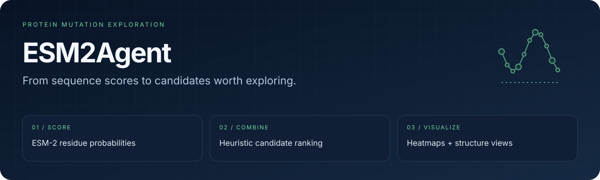

<div align="center">
  
  <h1>ESM2Agent</h1>
  <p><strong>Explore protein mutations with sequence scores and inspectable outputs.</strong></p>
  <p>
  
  </p>
  <p>
    <a href="#overview">Overview</a> ·
    <a href="#quick-start">Quick start</a> ·
    <a href="#workflow">Workflow</a> ·
    <a href="#validation">Validation</a> ·
    <a href="#documentation">Documentation</a>
  </p>
  <p><a href="README.en.md">English</a> · <a href="README.md">简体中文</a></p>
</div>

---

<a id="overview"></a>
## Connect sequence scores to candidate exploration

**ESM2Agent** is a set of ESM-2-based scripts for scoring substitutions, ranking mutation combinations and optionally incorporating structural and domain information. Outputs include CSV tables, heatmaps and interactive structure views.

| Score positions | Rank combinations | Inspect the result |
| :--- | :--- | :--- |
| Selected residues, Top-k substitutions and model probabilities | Multiplicative / additive / geometric heuristics and diversity selection | Heatmaps, candidate rankings and PDB residue views |

> [!NOTE]
> Model probabilities and combination scores are candidate-screening signals. They do not establish experimentally validated activity, stability or epistasis.

<a id="quick-start"></a>
## Quick start

Start with the lightweight Conda environment and install the libraries imported by the analysis scripts:

```bash
git clone https://github.com/eust-w/esm2agent.git
cd esm2agent
conda env create -f simple_environment.yml
conda activate esm_env
python -m pip install fair-esm numpy pandas matplotlib seaborn \
  biopandas networkx scipy py3Dmol
python mutation_prediction.py --help
```

The first prediction downloads ESM-2 weights. The predictor defaults to `esm2_t33_650M_UR50D` and selects **Apple MPS or CPU**; CUDA is not automatically selected by the current implementation.

```bash
python mutation_prediction.py \
  --sequence "$(cat /path/to/your_sequence.txt)" \
  --positions 10,20,30 --top_k 5 \
  --output mutations.csv --visualize --vis_output mutation_heatmap.png
```

Use a plain amino-acid sequence without a FASTA header. Positions are **1-based** and must be within sequence length. Use inputs you are authorized to process.

<a id="workflow"></a>
## An inspectable analysis chain

```text
Sequence → ESM-2 position scores → mutations.csv
                                      │
                      ┌───────────────┴──────────────┐
                      ▼                              ▼
              combinations + diversity        heatmaps + rankings
                      │
               optional PDB / domains
                      ▼
              structure-aware ranking + HTML view
```

### Rank combinations

```bash
python combo_mutation_design.py \
  --mutations_csv mutations.csv --output_prefix candidates \
  --top_positions 20 --mutations_per_position 2 --combo_size 3 --diversity
```

### Add optional structure information

```bash
python advanced_combo_mutation_design.py \
  --mutations_csv mutations.csv \
  --pdb_file /path/to/structure.pdb --domains_file /path/to/domains.csv \
  --output_prefix structured_candidates \
  --combo_size 3 --max_combinations 10000 --diversity --visualize_structure
```

Domain CSV columns are `domain_name,start_position,end_position`. PDB residue numbering must agree with sequence positions. PDB and domain inputs are optional.

### Render a heatmap from CSV

```bash
python generate_heatmap.py \
  --csv_file mutations.csv --output mutation_heatmap.png \
  --top_n 100 --max_per_chart 30
```

The script splits charts by default, so generated image names may include a part suffix.

| Output | Contents |
| :--- | :--- |
| Position CSV | Position, original residue, substitution, probability and log probability |
| Combination CSV / PNG | Candidate combinations and ranking plots |
| Diverse CSV / PNG | Diversity-selected candidates |
| Structure HTML | Residue view when PDB input is supplied |

<a id="validation"></a>
## Validation and limitations

```bash
python combo_mutation_design.py --help
python advanced_combo_mutation_design.py --help
python generate_heatmap.py --help
```

Start with a few valid positions and inspect the outputs. Combinatorial growth can be substantial; the advanced script provides `--max_combinations`. Structural/domain weights and “synergy” scores are heuristic, not validated physical predictions. No wet-lab validation or predictive-accuracy benchmark is claimed here.

<details>
<summary><strong>Existing demo and environment details</strong></summary>

`run_fhase_mutation.py` reads `fhase_sequence.txt` and writes fixed filenames. It has **no argument parser**. Use `mutation_prediction.py` for custom sequences and output options.

The larger `environment.yml` names its environment `esmfold` and pins older CUDA/OpenMM dependencies. The lightweight `simple_environment.yml` names its environment `esm_env`.

</details>

<a id="documentation"></a>
## Source map

| File | Responsibility |
| :--- | :--- |
| [mutation_prediction.py](mutation_prediction.py) | Model scoring and position plots |
| [combo_mutation_design.py](combo_mutation_design.py) | Combination ranking and diversity |
| [advanced_combo_mutation_design.py](advanced_combo_mutation_design.py) | Structure/domain-assisted ranking |
| [generate_heatmap.py](generate_heatmap.py) | CSV-to-heatmap rendering |
| [visualize_structure.py](visualize_structure.py) | Structure visualization helper |

## License and provenance

Code is licensed under [Apache-2.0](LICENSE), as specified by the repository's license file. ESM-2 and dependencies retain their own terms. Articles and figures under `reference/`, input sequences and structure data require separate rights review; the code license does not automatically cover them.
