# STRUCTUREPREDICTION

# Evolutionary-scale prediction of atomic-level protein structure with a language model

Zeming $\mathsf { L i n } ^ { 1 , 2 } \dag$ ,Halil Akinl+,Roshan Raol+,Brian ${ \mathsf { H i e } } ^ { 1 , 3 } \dag$ ,Zhongkai Zhu¹, Wenting Lu, Nikita Smetanin1, Robert Verkuil, Ori Kabeli1, Yaniv Shmueli¹, Allan dos Santos Costa4, Maryam Fazel-Zarandi1,Tom Sercu1, Salvatore Candido¹, Alexander Rives1,2\*

Recent advances in machine learning have leveraged evolutionary information in multiple sequence alignments to predict protein structure.We demonstrate direct inference of full atomic-level protein structure from primary sequence using a large language model. As language models of protein sequences are scaled up to 15 billion parameters,an atomic-resolution picture of protein structure emerges in the learned representations.This results in an order-of-magnitude acceleration of high-resolution structure prediction,which enables large-scale structural characterization of metagenomic proteins.We apply this capability to construct the ESM Metagenomic Atlas by predicting structures for ${ > } 6 1 7$ million metagenomic protein sequences,including $> 2 2 5$ million that are predicted with high confidence,which gives a view into the vast breadth and diversity of natural proteins.

he sequences of proteins at the scale of evolution contain an image of biological structure and function.The biological properties of a protein constrain the mutations to its sequence that are selected through evolution,recording biology into evolutionary patterns (1-3).Protein structure and function can therefore be inferred from the patterns in sequences (4,5). This insight has been central to progress in computational structure prediction starting from classical methods $( 6 , 7 )$ through the introduction of deep learning (8-I) up to present high-accuracy structure prediction (12,13).

Language models have the potential to learn patterns in protein sequences across evolution.This idea motivates research on evolutionary-scale language models (I4),in which basic models (15-I7) learn representations that reflect aspects of the underlying biology and,with greater representational capacity, capture secondary structure (14,I8) and tertiary structure (14,I9-21) ata low resolution.

Beginning with Shannon's model for the entropy of text (22),language models of increasing complexity have been developed, which has culminated in modern large-scale attention-based architectures (23-25).Despite the simplicity of their training objectives,such as filling in missing words or predicting the next word, language models of text are shown to exhibit emergent capabilities that develop as a function of scale in increasing computational power, data,and number of parameters.Modern language models containing tens to hundreds of billions of parameters show abilities such as few-shot language translation, commonsense reasoning,and mathematical problem solving,all without explicit supervision (26-29).

We posit that the task of filling in missing amino acids in protein sequences across evolution will require a language model to understand the underlying structure that creates the patterns in the sequences.As the representational capacity of the language model and the diversity of protein sequences seen in its training increase,we expect deep information about the biological properties of the protein sequences to emerge because those propertiesgive rise to the patterns that are observed in the sequences.To study this kind of emergence,we scale language models from 8 million parameters up to 15 billion parameters. We discover that atomic-resolution structure emerges and continues to improve in language models over the four orders of magnitude in parameter scale. Strong correlations between the language model's understanding of the protein sequence (perplexity) and the accuracy of the structure prediction reveal a close link between language modeling and the learning of structure.

We show that language models enable fast end-to-end atomic-resolution structure prediction directly from sequence. Our approach leverages the evolutionary patterns that are captured by the language model to produce accurate atomic-level predictions.This removes costly aspects of the current state-of-the-art structure prediction pipeline,which eliminates the need for a multiple sequence alignment (MSA)while greatly simplifying the neural architecture used for inference.This results in an improvement in speed of up to $6 0 \times$ on the inference forward pass alone while also removing the search process for related proteins entirely,which can take ${ > } 1 0 \ \mathrm { m i n }$ with the high-sensitivity pipelines used by AlphaFold(I2)and RoseTTAFold (I3)and is a meaningful part of the computational cost even with recent lower-sensitivity fast pipelines (30).In practice,this means the speedup over the state-of-the-art prediction pipelines is up to one to two orders of magnitude.

This speed advantage makes it possible to expand structure prediction to metagenomic scale datasets.The past decade has seen efforts to expand knowledge of protein sequences to the immense microbial natural diversity of Earth through metagenomic sampling.These efforts have contributed to an exponential growth in the size of protein sequence databases,which now contain billions of proteins (31-33). Computational structural characterizations have recently been completed for $\sim 2 0 { , } 0 0 0$ proteins in the human proteome (34) and the $\sim 2 0 0$ million cataloged proteins of Uniprot (35), but the vast scale of metagenomic proteins represents a far greater challenge for structural characterization.The extent and diversity of metagenomic structures is unknown and is a frontier for biological knowledge,as well as a potential source of discoveries for medicine and biotechnology (36-38).

Wepresent an evolutionary-scale structural characterization ofmetagenomic proteins that folds practically all sequences in MGnify90 (32), ${ > } 6 1 7 $ million proteins.We were able to complete this characterization in 2 weeks on a heterogeneous cluster of 2ooo graphics processing units (GPUs),which demonstrates scalability to far larger databases.High-confidence predictions are made for ${ > } 2 2 5$ million structures, which reveals and characterizes regions of metagenomic space distant from existing knowledge.Most $( 7 6 . 8 \% )$ high-confidence predictions are separate from UniRef9o (39) by at least $9 0 \%$ sequence identity,and tens of millions of predictions $( 1 2 . 6 \% )$ do not have any match to experimentally determined structures.These results givea large-scale view into the vast extent and diversity of metagenomic protein structures.These predicted structures can be accessed in the ESMMetagenomic Atlas (https://esmatlas.com) open science resource.

# Atomic-resolution structure emerges in language models trained on protein sequences

We begin with a study of the emergence of high-resolution protein structure.We trained a family of transformer protein language models, ESM-2,at scales from 8 million parameters up to l5 billion parameters.Relative to our previous generation model ESM-ib,ESM-2 introduces improvements in architecture, training parameters,and increases computational resources and data [supplementary material (SM) sections A.l.l and A.2]. The resulting ESM-2 model family outperforms previously state-of-the-art ESM-1b (a ${ \sim } 6 5 0$ million parameter model) at a comparable number of

Fig.1. Emergence of structure when scaling language models to 15 billion parameters. (A) Predicted contact probabilities (bottom right)and actual contact precision (top left) for PDB 3LYW. A contact is a positive prediction if it is within the top L most likely contacts for a sequence of length L. (B to D) Unsupervised contact prediction performance [long-range precision at L (P@L)] (SM A.2.1) for all scales of the ESM-2 model. (B) Performance binned by the number of MMseqs hits when searching the training set. Larger ESM-2 models perform better at all levels; the 150- million-parameter ESM-2 model is comparable to the 650-millionparameter ESM-1b model. (C) Trajectory of improvement as model scale increases for sequences with different numbers of MMseqs hits. (D) Left-to-right shows models from 8 million to 15 billion parameters,comparing

the smaller model ( $\chi$ axis)against the next larger model (y axis) through unsupervised contact precision.Points are PDB proteins colored by change in perplexity for the sequence between the smaller and larger model. Sequences with large changes in contact prediction performance also exhibit large changes in language model understanding measured by perplexity.(E) TM-score on combined CASPl4 and CAMEO test sets.Predictions are made by using parameters,and on structure prediction benchmarks it also outperforms other recent protein language models (table S1).

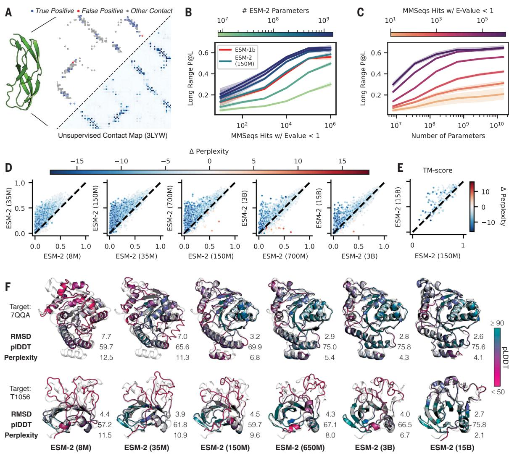  
structure module-only head on top of language models.Points are colored by the change in perplexity between the models.(F) Structure predictions on CAMEO structure 7QQA and CASP target 1056 at all ESM-2 model scales, colored by pLDDT (pink,low; teal,high).For 7QQA,prediction accuracy improves at the 15O-million-parameter threshold.For T1056,prediction accuracy improves at the 15-billion-parameter threshold.

ESM-2 is trained to predict the identity of amino acids that have been randomly masked out of protein sequences:

$$
\mathcal { L } _ { \mathrm { M L M } } = - \sum _ { i \in M } \log p ( x _ { i } | x _ { \{ M }  )
$$

where fora randomly generated mask $M$ that includes $1 5 \%$ of positions $_ { i }$ in the sequence $x ,$ the model is tasked with predicting the identity of the amino acids $x _ { i }$ in the mask from the surrounding context $x _ { \ M }$ ,excluding the masked positions.This masked language modeling objective (25) causes the model to learn dependencies between the amino acids.Although the training objective itself is simple and unsupervised,solving it over millions of evolutionarily diverse protein sequences requires the model to internalize sequence patterns across evolution.We expect that this training will cause biological structure to materialize in the language model because it is linked to the sequence patterns.ESM-2 is trained over sequences in the UniRef (39) protein sequence database.During training, sequences are sampled with even weighting across ${ \sim } 4 3$ million UniRef5o training clusters from $\mathord { \sim } 1 3 8$ million UniRef9o sequences,so that over the course of training, the model sees ${ \sim } 6 5$ million unique sequences.

As we increase the scale of ESM-2 from 8 million to 15 billion parameters,we observe large improvements in the fidelity of its modeling of protein sequences.This fidelity can be measured byusing perplexity,which ranges from 1 for a perfect model to 2o for a model that makes predictions at random.Intuitively, the perplexity describes the average number of amino acids that the model is choosing among for each position in the sequence.Mathematically,perplexity is defined as the exponential of the negative log-likelihood of the sequence (SMA.2.2).Figure S1 shows perplexity for the ESM-2 familyas a function of the number of training updates, evaluated on a set of ${ \sim } 5 0 0 { , } 0 0 0$ UniRef50 clusters that have been held out from training. Comparisons are performed at 27o,ooo training steps for all models in this section.The fidelity continues to improve as the parameters increase up to the largest model. The 8-million-parameter model has a perplexity of 10.45,and the 15 billion model reaches a perplexity of 6.37,which indicates a large improvement in the understanding of protein sequences with scale.

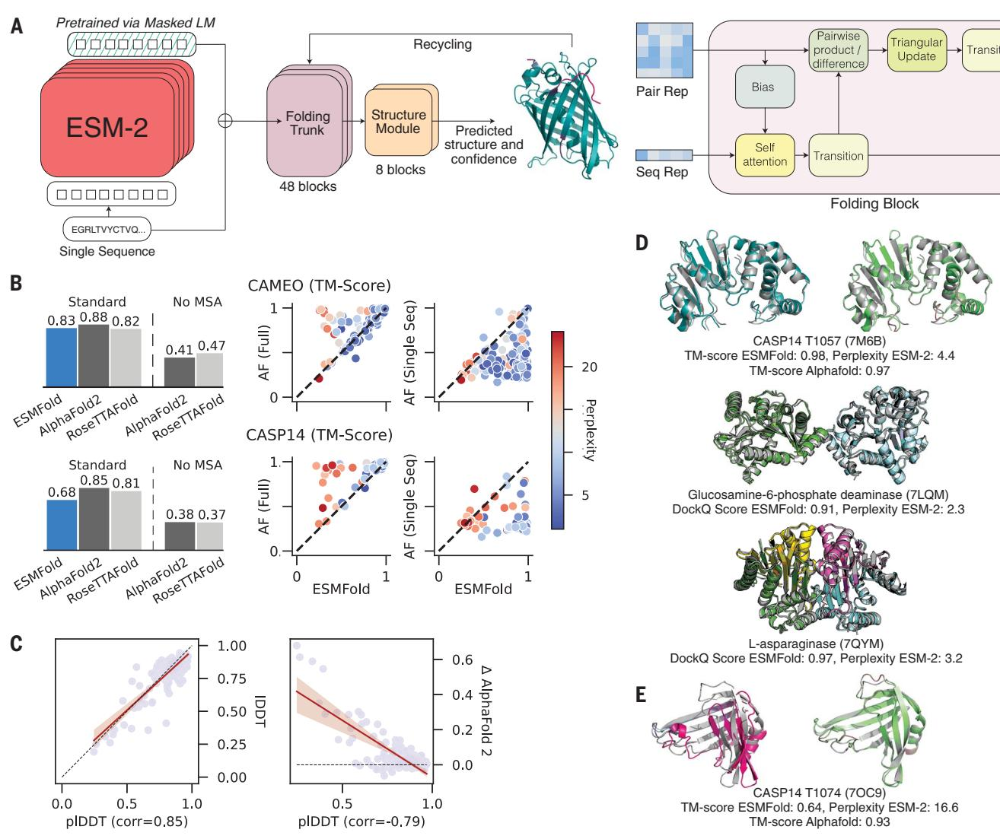  
Fig.2. Single sequence structure prediction with ESMFold.(A) ESMFold model architecture.Arrows show the information flow in the network from the language model to the folding trunk to the structure module that outputs 3D coordinates and confidences.LM,language model.(B) ESMFold produces accurate atomic resolution predictions,with similar accuracy to RoseTTAFold on CAMEO.When MSAsare ablated for AlphaFold and RoseTTAFold,performance of the models degrades.Scatterplots compare ESMFold (x axis)predictions with AlphaFold2(y axis), colored by language model perplexity. Proteins with low perplexity score similarly to AlphaFold2.AF,AlphaFold2.(C) Model pLDDT versus true LDDT (left) and relative performance against AlphaFold (right) on CAMEO.pLDDT is a well-calibrated estimate of prediction accuracy.(D) Successful examples:Top shows test-set predictions of T1057,with ESMFold (left)and AlphaFold2 (right). Coloring shows

predicted LDDT for both models (ESMFold high confidence,teal; AlphaFold2 high confidence,green; both low confidence,pink). Ground truth is shown in gray. The bottom two show complex predictions on a dimer (PDB:7LQM) and a tetramer (PDB:7QYM); ESMFold predictions are colored by chain ID and overlaid on ground truth (gray).DockQ (5O) scores are reported for the interactions; in the case of the tetramer 7QYM,the score is the average of scores over interacting chain pairs. (E) Unsuccessful example: test-set predictions of T1O74,with ESMFold (left) and AlphaFold2 (right).Coloring shows predicted LDDT for both models (ESMFold high confidence,teal; AlphaFold2 high confidence,green; both low confidence, pink). Ground truth is shown in gray.ESMFold TM-score is substantially below AlphaFold2 TM-score.The perplexity of the unsuccessful sequence is 16.6, meaning the language model does not understand the input sequence.

This training also results in the emergence of structure in the models.Because ESM-2's training is only on sequences,any information about structure that develops must be the result of representing the patterns in sequences.Transformer models that are trained with masked language modeling are known to develop attention patterns that correspond to the residue-residue contact map of the protein (19,20).We examine how this low-resolution picture of protein structure emerges as a function of scale.We use a linear projection to extract the contact map from the attention patterns of the language model (SM A.2.1).The precision of the top L (length of the protein) predicted contacts (long-range contact precision） measures the correspondence of the attention pattern with the structure of the protein.Attention patterns develop in ESM-2 that correspond to tertiary structure (Fig.lA),and scaling leads to large improvements in the understanding of structure (Fig. IB).The accuracy of the predicted contacts varies as a function of the number of evolutionarily related sequences in the training set. Proteins with more related sequences in the training set have steeper learning trajectories with respect to model scale (Fig.IC).Improvement on sequences with high evolutionary depth thus saturates at lower model scales, and improvement on sequences with low evolutionary depth continues as models increase in size.

For individual proteins,we often observe nonlinear improvements in the accuracy of the contact prediction as a function of scale.

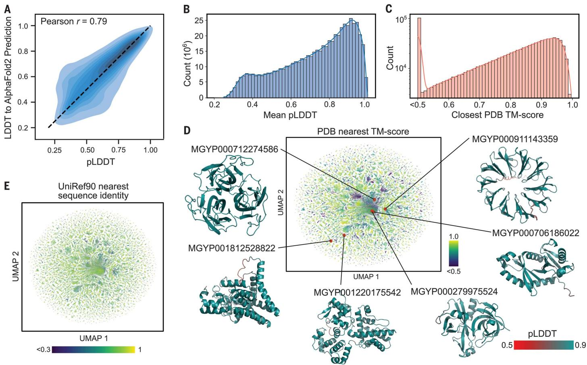  
Fig.3.Mapping metagenomic structural space.(A) ESMFold calibration with AlphaFold2 for metagenomic sequences.Mean pLDDT is shown on the x axis,and LDDT to the corresponding AlphaFold2 prediction is shown on the y axis. Distribution is shown as a density estimate across a subsample of \~4000 sequences from the MGnify database.(B) Distribution of mean pLDDT values computed for each of ${ \sim } 6 1 7 $ million ESMFold-predicted structures from the MGnify database.(C) The distribution of the TM-score to the most similar PDB structure for each of 1 million randomly sampled high-confidence (mean pLDDT $> 0 . 7$ and $\mathsf { p T M } > 0 . 7$ )structures.Values were obtained bya Foldseek search,which does

not report values under O.5 TM-score (53).(D) Sample of 1 millon highconfidence protein structures is visualized in two dimensions by using the UMAP algorithm and colored according to distance from the nearest PDB structure,in which regions with low similarity to known structures are colored in dark blue. Example protein structures and their locations within the sequence landscape are provided; see also Fig.4 and table S2.(E) Additional UMAP plot in which the 1 million sequences are plotted according to the same coordinates as in (D) but colored by the sequence identity to the most similar entry in UniRef9O according to a blastp (60) search.

Plotting the change in the distribution of longrange contact precision at each transition to a higher level of scale reveals an overall shift in the distribution toward better performance (Fig.ID),as well as a subset of proteins that undergo greater improvement. The accuracy of the contact map prediction and perplexityare linked, with proteins undergoing large changes in contact map accuracy also undergoing large changes in perplexity [normalized discounted cumulative gain $( \mathrm { N D C G } ) = 0 . 8 7 ]$ (SM A.2.6).This link indicates that the language modeling objective is directly correlated with the materialization of the folded structure in the attention maps.

To identify atomic-resolution information in the model,we project out spatial coordinates for each of the atoms from the internal representations of the language model using an equivariant transformer (SMA.3.3).This projection is fitted by using experimentally determined protein structures from the Protein Data Bank (PDB) (4O) and evaluated on 194 CAMEO proteins (4I) and 51 CASP14 proteins (42).TM-score,which ranges from O to 1, measures the accuracy of the projection in comparison to the ground truth structure, with a value of O.5 corresponding to the threshold for correctly predicting the fold (43). The evaluation uses a temporal cutoff,which ensures that the proteins used for testing are held out from those used in fitting the projection. This makes it possible to measure how atomiclevel information emerges in the representations asa function of the parameter scale.

We discover that an atomic-resolution structure prediction can be projected from the representations of the ESM-2 language models. The accuracy of this projection improves with the scale of the language model. The 15 billion parameter model reachesa TM-score of 0.72 on the CAMEO test set and 0.55 on the CASP14 test set,a gain of 14 and $1 7 \%$ respectively relative to the l5O million parameter ESM-2 model (Fig.IE).At each increase in scale a subset of proteins undergoes large changes in accuracy.For example, the protein 7QQA improves in root mean square deviation (RMSD) from 7.0 to $3 . 2 \mathrm { ~ \AA ~ }$ when the scale is increased from 35 million to 150 million parameters,and the CASP target T1056 improves in RMSD from 4.0 to $2 . 6 \textup { \AA }$ when the scale is increased from 3 billion to 15 billion parameters (Fig.IF).Before and after these jumps,changes in RMsD are much smaller. Across all models (table S1),there is a correlation of $- 0 . 9 9$ between validation perplexityand CASPl4 TM-score and -1.0o between validation perplexity and CAMEO TM-score, which indicates a strong connection between the understanding of the sequence measured by perplexity and the atomic-resolution structure prediction. Additionally, there are strong correlations between the low-resolution picture of the structure that can be extracted from the attention maps and the atomic-resolution prediction (O.96 between long-range contact precision and CASP14 TM-score and 0.99 between long-range contact precision and CAMEO TM-score). These findings connect improvements in language modeling with the increases in low-resolution (contact map）and highresolution (atomic-level) structural information.

# Accelerating accurate atomic-resolution structure prediction with a language model

Language models greatly accelerate state-ofthe-art high-resolution structure prediction. The language model internalizes evolutionary patterns linked to structure,which eliminates the need for external evolutionary databases, MSAs,and templates.We find that the ESM-2 language model generates state-of-the-art three-dimensional (3D) structure predictions directly from the primary protein sequence, which results in a speed improvement for structure prediction of more than an order of magnitude while maintaining high-resolution accuracy.

We developed ESMFold,a fully end-to-end single-sequence structure predictor,by traininga folding head for ESM-2 (Fig.2A).At prediction time,the sequence of a protein is inputted to ESM-2.The sequence is processed through the feedforward layers of the language model,and the model's internal states (representations)are passed to the folding head.The head begins with a series of folding blocks.Each folding block alternates between updating a sequence representation and a pairwise representation.The output of these blocks is passed to an equivariant transformer structure module,and three steps of recycling are performed before outputting afinal atomic-level structure and predicted confidences (SM A.3.1).This architecture represents a major simplification in comparison with current state-of-the-art structure prediction models,which deeply integrate the MSA into the neural network architecture through an attention mechanism that operates across the rows and columns of the MSA (I2,44).

Our approach results in a considerable improvement in prediction speed. On a single NVIDIA VlOO GPU, ESMFold makes a prediction on a protein with 384 residues in $^ { 1 4 . 2 \ 8 , }$ six times faster than a single AlphaFold2 model. On shorter sequences,the improvement increases up to $\mathord { \sim } 6 0 \times$ (fig. S2). The search process for related sequences,which is required to construct the MSA,can take ${ > } 1 0 \ \mathrm { m i n }$ with the high-sensitivity protocols used by the published versionsofAlphaFoldandRoseTTAFold; this time can be reduced to ${ < } 1 \mathrm { m i n }$ ,although with reduced sensitivity (30).

We train the folding head on $\sim 2 5 { , } 0 0 0$ clusters covering a total of \~325,000 experimentally determined structures from the PDB, whichis furtheraugmentedwitha dataset of ${ \sim } 1 2$ million structures that we predicted with AlphaFold2 (SM A.1.2). The model is trained with the same losses that are used for AlphaFold (45).To evaluate the accuracy of structure predictions,we use test sets that are held out from the training data by a May 2020 cutoff date; as a result, all structures that are used in evaluation are held out from the training,and the evaluationisrepresentative of the performance that would be expected in regular usage as a predictive model on the kinds of structures that are selected by experimentalists for characterization.This also makes it possible to compare with AlphaFold and RoseTTAFold because these models also have not been trained on structures deposited after May 2020.Weuse two test sets: The CAMEO test set consists of 194 structures that areused in the ongoing CAMEO assessment (between April 2022 and June 2022); the CASP14 test set consists of 5l publicly released structures that have been selected for their difficulty for the biannual structure prediction competition.

We compare the results of ESMFold on these evaluationsets to AlphaFold2 and RoseTTAFold (Fig.2B).ESMFold achieves an average TM-score of 0.83 on CAMEO and 0.68 on CASP14. Using the search protocols released with AlphaFold2, including MSAs and templates,AlphaFold2 achieves 0.88 and 0.85 on CAMEO and CASP14, respectively.ESMFold achieves competitive accuracy with RoseTTAFold on CAMEO,which averagesa TM-score of 0.82.When evaluating AlphaFold2 and RoseTTAFold on single sequences byablating the MSA,their performance degrades substantially and falls well below that of ESMFold.This is an artificial setting because AlphaFold2 has not been explicitly trained for single sequences;however, it has recently emerged as important in protein design,in which these models have been used with single-sequence inputs for de novo protein design (46-48).

Although the average performance on the test sets is below AlphaFold2,the performance gaps are explained by the language model perplexity. On proteins for which perplexity is low,ESMFold results match AlphaFold2.On the CAMEO test set, the 3-billion-parameter ESM-2 model used in ESMFold achieves an average perplexity of 5.7.On the CASP14 test set, the same model only has an average perplexity of1o.0.Performance within each set is also well correlated with perplexity. On the CAMEO test set,language model perplexity has a Pearson correlation of $- 0 . 5 2$ with the TMscore between the predicted and experimental structures;on CASP14, the correlation is $- 0 . 7 1$ (Fig.2B).On the subset of 18 CASP14 proteins for which ESM-2 achieves perplexity $\mathrm { < } 7 ,$ ESMFold matches AlphaFold in performance (average TM-score difference ${ < } 0 . 0 3$ and no TM-score differences ${ > } 0 . 1$ ).The relationship between perplexity and structure prediction suggests that improvements in the language model will translate into improvements in single-sequence structure prediction accuracy, which is consistent with observations from the scaling analysis (Fig.1, Dand E).Additionally, this means that the language model's perplexity for a sequence can be used to predict the quality of the ESMFold structure prediction.

Ablation studies indicate that the language model representations are critical to ESMFold performance (fig. S3).With a folding trunk of eight blocks,performance on the CAMEO test setis O.74 local distance difference test (LDDT) (baseline).Without the language model, this degrades substantially, to 0.58LDDT.When removing the folding trunk entirely (i.e., only using the language model and the structure module), the performance degrades to 0.66 LDDT.Other ablations, such as only one block of a structure module, turning off recycling, not using AlphaFold2 predicted structures as distillation targets,or not using triangular updates,result in small performance degradations (change in LDDT of $- 0 . 0 1$ to $- 0 . 0 4 $

ESMFold provides state-of-the-art structure prediction accuracy,matching AlphaFold2 performance ( $_ { < 0 . 0 5 }$ LDDT difference）on more than half the proteins (Fig.2B).We find that this is true even on some large proteins-T1076 is an example with 0.98 TM-score and 540 residues (Fig.2D).Parts of the structure with low accuracy do not differ notably between ESMFold and AlphaFold,which suggests that language models are learning information similar to that contained in MSAs.We also observe that ESMFold is able to make good predictions for components of homo- and heterodimeric protein-protein complexes (Fig.2D). In a comparison with AlphaFold-Multimer (49) on a dataset of 2,978 recent multimeric complexes deposited in the PDB, ESMFold achieves the same qualitative DockQ(5O) categorization for $5 3 . 2 \%$ of chain pairs,despite not being trained on protein complexes (fig. S4).

Confidence is well calibrated with accuracy. ESMFold reports confidence in the form of predicted LDDT (pLDDT) and predicted TM (pTM). This confidence correlates well with the accuracy of the prediction,and for high-confidence predictions $\mathrm { ( p L D D T > 0 . 7 , }$ ),the accuracy is comparable to AlphaFold2 (ESMFold LDDT $= 0 . 8 3$ AlphaFold2 $\mathrm { L D D T } = 0 . 8 5$ on CAMEO) (Fig.2C and fig. S5).High-confidence predictions approach experimental-level accuracy. On the CAMEO test set,ESMFold predictions have a median all-atom $\mathrm { R M S D } _ { 9 5 }$ (RMSD at $9 5 \%$ residue coverage) of 1.91 A and backbone $\mathrm { R M S D } _ { 9 5 }$ of 1.33A When confidence is very high (pLDDT $> 0 . 9 \AA ,$ ), predictions have median all-atom $\mathrm { R M S D } _ { 9 5 }$ of 1.42A and backbone $\mathrm { R M S D } _ { 9 5 }$ of $0 . 9 4 \mathrm { \AA }$ The confidence can thus be used to predict how

# A MGYP000279975524

# MGYP000712274586

# MGYP001220175542

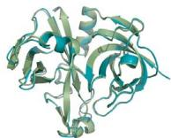

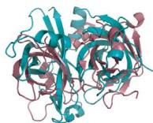

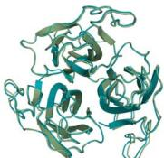

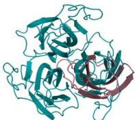

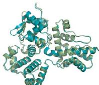

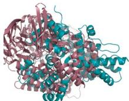

ESMFold/AlphaFold2   
RMSD: 0.59A   
TM-score:0.99   
ESMFold/PDB4L5S_B   
RMSD:5.4A   
TM-score:0.49   
ESMFold /AlphaFold2   
RMSD:0.49A   
TM-score:1.0   
ESMFold/PDB 1TTG_A   
RMSD:5.0A   
TM-score:0.45   
ESMFold/AlphaFold2   
RMSD:1.0A   
TM-score:0.98   
ESMFold/PDB5Y1X_A   
RMSD:6.4A   
TM-score:0.38

# MGYP001812528822

# MGYP000706186022

# MGYP000911143359

S

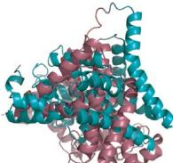

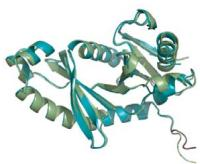

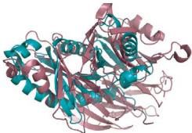

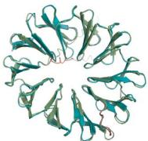

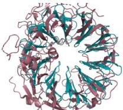

ESMFold/AlphaFold2  
RMSD:1.1A  
TM-score:0.98  
ESMFold/PDB 5HH3_C  
RMSD:11A  
TM-score:0.39  
ESMFold/AlphaFold2  
RMSD:0.85A  
TM-score:0.96  
ESMFold/PDB1XKS_A  
RMSD:5.8A  
TM-score:0.47  
ESMFold/AlphaFold2  
RMSD:1.2A  
TM-score:0.94  
ESMFold/PDB 5NNI_A  
RMSD:5.8A  
TM-score:0.67

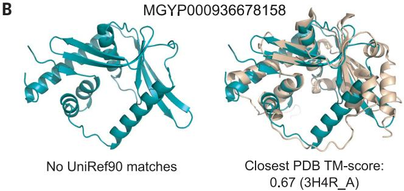  
Fig. 4. Example ESMFold structure predictions of metagenomic sequences. (A) Example predicted structures from six different metagenomic sequences; also see table S2.Left of each subfigure:The prediction is displayed with the AlphaFold2 prediction (light green).Right of each subfigure:The prediction is displayed with the Foldseek-determined nearest PDB structure according to TM-score.(B and C) Examples of two ESMFold-predicted structures that have

# MGYP004000959047

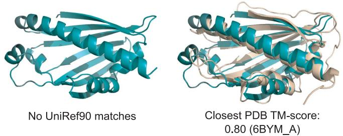  
good agreement with experimental structures in the PDB but that have low sequence identity to any sequence in UniRef9O.(B) Predicted structure of MGYP000936678158 aligns to an experimental structure from a bacterial nuclease (light brown,PDB: 3H4R),whereas (C) the predicted structure of MGYPOO40oo959O47 aligns to an experimental structure from a bacterial sterol binding domain (light brown, PDB: 6BYM).

likely it is that a given structure prediction will match the true structure if it were to be experimentallydetermined.

Recent work has investigated theuse of language models for the direct prediction of protein structure from sequence,without a learned full atomic-level structure projection, but the accuracy has not been competitive with the use ofMSAs(21, 5I).Anapproach developed concurrently with ours that uses a similar attention-based processing of language model representations to output atomic coordinates also appears to show results that are MSAs (52).

# Evolutionary-scale structural characterization of metagenomics

This fast and high-resolution structure prediction capability enables the large-scale structural characterization of metagenomic proteins. We fold ${ > } 6 1 7 $ million sequences from the MGnify90 database (32).This is the entirety of the sequences of length 20 to l024 and covers $9 9 \%$ of all the sequences in MGnify90.

Overall, the characterization produces \~365 million predictions with good confidence (mean $\mathrm { p L D D T } > 0 . 5$ and $\mathrm { p T M } > 0 . 5$ ),which corresponds to ${ \sim } 5 9 \%$ of the database, and ${ \sim } 2 2 5$ million predictions with high confidence (mean pLDDT $>$ 0.7 and $\mathrm { p T M } > 0 . 7 $ ,which corresponds to $\sim 3 6 \%$ of total structures folded (Fig.3).We were able to complete the predictions in 2 weeks on a cluster of \~2000 GPUs (SM A.4.1).

Forstructure prediction at scale,it is critical to distinguish well-predicted proteins from those that are poorly predicted.In the previous section,we evaluated calibration against experimentally determined structures on held-out test sets and found that the model confidence is predictive of the agreement with experimentally determined structures.We also assess calibration against AlphaFold predictions on metagenomic proteins.On a random subset of $\mathord { \sim } 4 0 0 0$ metagenomic sequences, there is a high correlation (Pearson $r = 0 . 7 9 $ ）between ESMFold pLDDT and the LDDT to AlphaFold2 predictions (Fig. 3A).When combined with results on CAMEO showing that when confidence is very high $\mathrm { ( p L D D T > 0 . 9 ) }$ ,ESMFold predictions often approach experimental accuracy, these findings mean that ESMFold's confidence scores provide a good indication of the agreement with experimental structures and with the predictions that can be obtained from AlphaFold2.Across the\~617 million predicted structures,\~Il3 million structures meet the very high-confidence threshold.

Many of the metagenomic structure predictions have high confidence (Fig.3B) and are not represented in existing structure databases (Figs.3,C to E).Ona random sample of 1 million high-confidence structures, $7 6 . 8 \%$ (767,580) of the proteins have a sequence identity below $9 0 \%$ to any sequence in UniRef90, which indicates that these proteins are distinct from existing UniRef9o sequences (Fig. 3E).For $3 . 4 \%$ (33,521 proteins), no match is found in UniRef90 at all (SM A.4.2).We use Foldseek (53) to compare the predicted structures with known structures in the PDB.At thresholds of O.7and 0.5 TM-score,Foldseek reports $2 5 . 4 \%$ (253,905 proteins) and $1 2 . 6 \%$ (125,765 proteins)without a match,respectively (Fig.3, Cand D).For $2 . 6 \%$ (25,664) there is both low structural similarity(TM-score $\le 0 . 5$ and no close sequencehomolog( ${ \it 5 3 0 \% }$ identity). On the basis of these subsampled estimates, there are ${ \sim } 2 8$ million proteins $( 1 2 . 6 \%$ of 225 million) with both high-confidence predictions and TM-score $< 0 . 5$ to known protein structures (examples in Fig.4A and table S2).These results demonstrate that ESMFold can effectively characterize regions of protein space that are distant from existing knowledge.

Large-scale structural characterization also makes it possible to identify structural similarities in the absence of sequence similarity. Many high-confidence structures with low similarity to UniRef9o sequences do have similar structures in the PDB.This remote homology often extends beyond the limit detectable by sequence similarity.For example,MGnify sequence MGYP000936678158 has no matches to any entry in UniRef9o or through a jackhmmer (54) reference proteome search,but it has a predicted structure conserved across many nucleases (PDB: 5YET_B, TM-scOre 0.68;PDB: 3HR4_A, TM-score 0.67) (Fig. 4B and table S2); similarly, MGnify sequence MGYP004000959047 has no UniRef9o or jackhmmer reference proteome matches,but its predicted structure has a high similarity to the experimental structures of lipid binding domains (PDB: 6BYM_A, TMscore 0.80; PDB: 5YQP_B, TM-sc0re 0.78) (Fig. 4C and table S2).The ability to detect remote similarities in structure enables insight into function that cannot be obtained from the sequence.

All predicted structures are available in the ESMMetagenomic Atlas (https://esmatlas.com) as an open science resource.Structures are available for bulk download,bymeans of an application programming interface (API),and through a web resource that provides search bystructure and by sequence (53,55).These tools facilitate both large-scale and focused analysis of the full scope of the hundreds of millions of predicted structures.

# Conclusions

Fast and accurate computational structure prediction has the potential to accelerate progress toward an era in which it is possible to understand the structure of all proteins discovered in gene sequencing experiments. Such tools promise insights into the vast natural diversity of proteins,most of which are discovered in metagenomic sequencing. To this end,we have completed a large-scale structural characterization of metagenomic proteins that reveals the predicted structures of hundreds of millions of proteins,millions of which are expected to be distinct in comparison to experimentally determined structures.

As structure prediction continues to scale to larger numbers of proteins,calibration becomes critical because,when the throughput of prediction is limiting, the accuracy and speed of the prediction forma joint frontier in the number of accurate predictions that can be generated.Very high-confidence predictions in the metagenomic atlas are expected to often be reliable at a resolution sufficient for insight similar to experimentally determined structures,such as into the biochemistry of active sites (56).For many more proteins for which the topology is predicted reliably, insight can be obtained into function through remote structural relationships that could not be otherwise detected with sequence.

The emergence of atomic-level structure in language models shows a high-resolution picture of protein structure encoded by evolution into protein sequences that can be captured with unsupervised learning. Our current models are very far from the limit of scale in parameters, sequence data,and computing power that can in principle be applied.We are optimistic that as we continue to scale, there will be further emergence. Our results showing the improvement in the modeling of low depth proteins point in this direction.

ESM-2 results in an advance in speed that in practical terms is up to one to two orders of magnitude,which puts far larger numbers of sequences within reach of accurate atomiclevel prediction. Structure prediction at the scale of evolution can opena deep viewinto the natural diversity of proteins and accelerate the discovery of protein structures and functions.

# REFERENCES AND NOTES

1.C.Yanofsky,V. Horn, D.Thorpe,Science 146,1593-1594 (1964).   
2. D.Altschuh,T.Vernet,P.Berti,D.Moras,K. Nagai, Protein Eng. 2,193-199 (1988).   
3. U. Gobel, C. Sander, R.Schneider,A.Valencia, Proteins 18, 309-317 (1994).   
4. A. S. Lapedes, B.G. Giraud,L. Liu, G. D. Stormo, Lect. Notes Monogr. Ser.33,236-256 (1999).   
5. J.Thomas,N.Ramakrishnan, C. Bailey-Kellogg,IEEE/ACM Trans.Comput. Biol. Bioinform.5,183-197 (2008).   
6. M. Weigt, R.A.White, H. Szurmant, J.A. Hoch,T. Hwa, Proc. Natl. Acad.Sci. U.S.A.106,67-72 (2009).   
7. F.Morcos et al.,Proc.Natl.Acad.Sci.U.S.A.108, E1293-E1301 (2011).   
8.S.Wang,S.Sun,Z. Li, R. Zhang,J. Xu, PLOS Comput. Biol.13, e1005324 (2017).   
9. Y. Liu,P.Palmedo, Q.Ye,B. Berger,J.Peng,Cell Syst.6, 65-74.e3 (2018).   
10.A.W.Senior et al., Nature 577,706-710 (2020).   
11.J. Yang et al.,Proc.Natl.Acad.Sci. U.S.A.117,1496-1503 (2020).   
12.J. Jumper et al., Nature 596,583-589 (2021).   
13.M. Baek et al., Science 373,871-876 (2021).   
14.A. Rives et al., Proc. Natl. Acad. Sci. U.S.A.118,e2016239118 (2021).   
15.T. Bepler, B. Berger, Cell Syst.12,654-669.e3 (2021).   
16.E. C.Alley,G. Khimulya,S. Biswas, M. AlQuraishi, G. M. Church, Nat. Methods 16,1315-1322 (2019).   
17.M. Heinzinger et al.,BMC Bioinformatics 20,723 (2019).   
18.A.Elnaggar et al.,IEEE Trans.Pattern Anal. Mach.Intell.14, 1 (2021).   
19.J.Vig et al.,arXiv:2006.15222 [cs,q-bio] (2021).   
20.R. Rao,J. Meier,T.Sercu, S. Ovchinnikov,A. Rives, bioRxiv 422761 [Preprint](2021); htps://doi.org/10.1101/ 2020.12.15.422761.   
21.R. Chowdhury et al., Nat. Biotechnol.40,1617-1623 (2022).   
22.C.E.Shannon,Bel Syst.Tech.J.30,50-64 (1951).   
23.A.Vaswani et al.,in Advances in Neural Information Processing Systems (Curran Associates,2017),pp.5998-6008.   
24.A. Radford,K.Narasimhan,T.Slimans,l.Sutskever,Improving language understanding by generative pre-training (2O18); https:// cdn.openai.com/research-covers/language-unsupervised/ language_understanding_paper.pdf.   
25.J. Devlin,M.-W.Chang,K.Lee,K.Toutanova,in Procedings of the 2Ol9 Conference of the North American Chapter of the Asociation for Computational Linguistics: Human Language Technologies,Volume1(Longand ShortPapers)(Association for Computational Linguistics,2019),pp.4171-4186.   
26.T.B.Brown etal.,in Advances in Neural Information Processing Systems (Curran Associates,2020),pp.1877-1901.   
27.J.Wei et al.,arXiv:2109.01652 [cs.CL] (2021).   
28.J.Wei et al.,arXiv:2201.11903[cs](2022).   
29.A.Chowdhery et al.,arXiv:2204.023ll [cs](2022).   
30.M. Mirdita et al., Nat. Methods 19,679-682 (2022).   
31.M.Steinegger, M. Mirdita,J.Soding,Nat. Methods16,603-606 (2019).   
32.A.L. Mitchell et al., Nucleic Acids Res.48, D570-D578 (2020).   
33.S. Mukherjee et al., Nucleic Acids Res.49 (D1), D723-D733 (2021).   
34.K.Tunyasuvunakool et al., Nature 596, 590-596 (2021).   
35.M. Varadi et al., Nucleic Acids Res.50, D439-D444 (2022).   
36.O.Shimomura,F. H. Johnson, Y. Saiga,J.Cell. Comp.Physiol. 59,223-239 (1962).   
37.K. Mulis et al., Cold Spring Harb. Symp. Quant. Biol. 51, 263-273 (1986).   
38.M. Jinek et al., Science 337,816-821 (2012).   
39.B.E.Suzek,Y. Wang,H. Huang,P.B. McGarvey, C. H.Wu; UniProt Consortium,Boinformatics31,926-93 (2015).   
40.S. K. Burley et al.,Nucleic Acids Res.47(D1),D464-D474 (019).   
41.J.Haas et al.,Proteins 86 (suppl.1),387-398 (2018).   
42.A. Kryshtafovych,T.Schwede,M.Topf,K.Fidelis,J.Moult, Proteins 89,1607-1617 (2021).   
43.Y. Zhang,J.Skolnick,Proteins 57,702-710 (2004).   
44.R.M.Rao etal.,in Proceedings of the 38th International Conference on Machine Learning (PMLR,2021),pp.8844-8856.   
45.G.Ahdritz et al.,bioRxiv 517210[Preprint](2022). https://doi.or/10.1101/2022.11.20.517210.   
46.J. Dauparas et al., Science 378,49-56 (2022).   
47.J.Wang et al., Science 377,387-394 (2022).   
48.B.I. M.Wickyet al.,Science 378,56-61(2022).   
49.R.Evans et al.,bioRxiv 463034 [Preprint] (2021). https://doi.0rg/10.1101/2021.10.04.463034.   
50.S. Basu, B.Wallner,PLOS ONE 11,e0161879 (2016).   
51.K.Weissenow,M. Heinzinger,B. Rost, Structure 30,1i69-177.e4 (2022).   
52.R.Wu et al., bioRxiv 500999 [Preprint] (2022).   
53.M.van Kempen et al., bioRxiv 479398 [Preprint] (2022). https://doi.org/10.1101/2022.02.07.479398.   
54.S. C.Potter et al., Nucleic Acids Res.46,W20O-W204 (2018).   
55..te   
56.Y. Zhang,Curr Opin. Struct. Biol.19,145-155 (2009).   
57.Z.Lin et al., ESM-2 and ESMFold-vO Model Code and Weights, Zenodo (2023). https://doi.org/10.5281/zenodo.7566741.   
58. Z. Lin et al.,ESM Atlas vO representative random sample of predicted protein structures, Zenodo (2022).htps://doi.org/ 10.5281/zenodo.7623482.   
59.Z.Lin et al.,ESM Atlas vO random sample of high confidence predicted protein structures,Zenodo (2022).htps://doi.org/ 10.5281/zenodo.7623627.   
60.S.F.Altschul,W.Gish,W.Miler,E.W.Myers,D.J.Lipman, J. Mol. Biol.215,403-410 (1990).

# ACKNOWLEDGMENTS

We thank FAlR team members N. Goyal, Y. LeCun,A. Lerer, J. Liu,L.van der Maaten,and S.Sukhbaatar and collaborators J. Dauparas and S. Ovchinnikov for technical help,feedback,and discussions that helped shape this project. We thank E. Koonin and F.Zhang for feedback on the metagenomic dataset.We thank A. Rizvi, J. Shepard,and J.Spisak for program support. We thank S.Gomez, S. Jain,W. Ngan,and N. Seejoor for their work on the ESM Metagenomic Atlas website.We also thank the developers of the OpenFold project,fairseq,PyTorch,Foldseek, MMseqs2, PyMol, Biotite,and others for building invaluable open-source tools and the creators and maintainers of MGnify,PDB, UniProt,and UniRef,as well as the researchers whose experimental efforts are included in these resources.Funding:There were no external

sources of funding for the project.Author contributions: Conceptualized and initiated the project: Z.L., S.C.,and A.R.; developed and trained ESM-2: H.A., Z.Z., W..,and R.V.; developed and trained ESMFold: Z.L., R.R., Z.Z., N.S., A.S.C., M.F.Z., and S.C.; produced metagenomic structure predictions: Z.L., H.A.,and W.L.; analyzed ESM-2 and ESMFold: Z.L., R.R., Z.., and W.L.; analyzed predicted metagenomic structures: B.H. and T.S.; developed ESM Atlas: B.H., N.S., O.K., Y.S., and T.S.; wrote the manuscript: Z.L., H.A., R.R., B.H., and A.R.; engineering and science leadership: T.S., S.C.,and A.R. Competing interests: The authors declare no competing financial interests.No patent applications have been filed on this work. Data and materials availability: All predicted structures in the ESM Metagenomic Atlas are

available at https://esmatlas.com. ESM-2 and ESMFold model source code and parameters are available at https://github. com/facebookresearch/esm and archived on Zenodo (57).A representative random sample of ${ \sim } 1$ million predicted structures is archived on Zenodo (58),and the random sample of \~1 million high-confidence predictions used for analysis in this work is also archived on Zenodo (59). Models and data have been released under permissive licenses (MIT license for model source code and parameters and CC-BY for predicted structures).License information: Copyright $\circledcirc$ 2023 the authors,some rights reserved; exclusive licensee American Association for the Advancement of Science. No claim to original US government works. https://www. sciencemag.org/about/science-licenses-journal-article-reuse

# SUPPLEMENTARY MATERIALS

science.org/doi/10.1l26/science.ade2574   
Materials and Methods   
Supplementary Text   
Figs. S1 to S8   
Tables S1 to S5   
References (61-74)

View/request a protocol for this paper from Bio-protocol.

Submitted 3 August 2022; resubmitted 10 November 2022   
Accepted 16 February 2023   
10.1126/science.ade2574